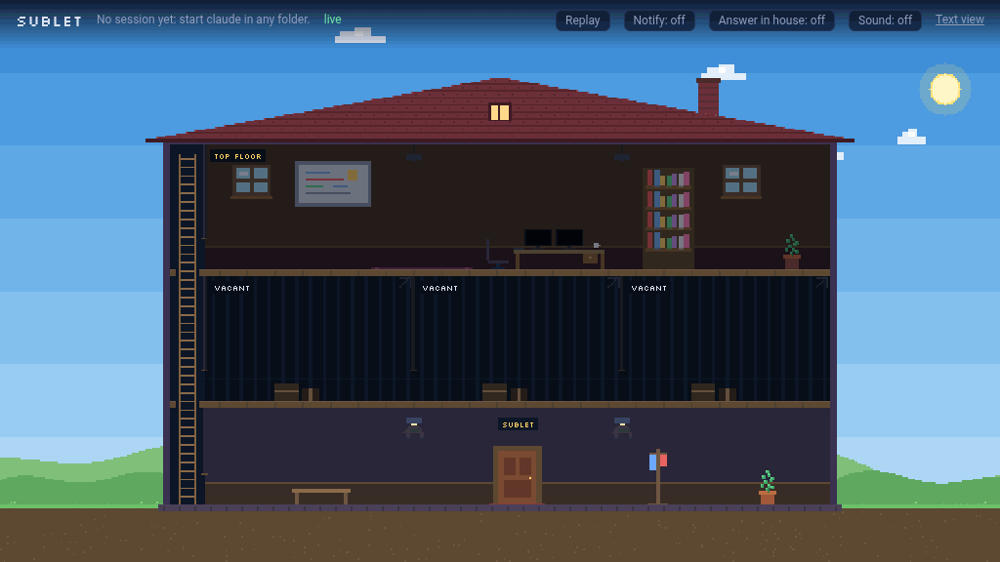

# Sublet

Your subagents sublet a room. Watch your Claude Code sessions live as a pixel house.



The main agent works on the top floor. Every subagent comes in through the front door, gets its own room and types away at its desk while it works. When it sends another agent a message, it walks over and knocks. When it is done, it brings its report to the boss, packs a moving box and leaves. If you run several sessions at once, their houses stand side by side in a little street.

Everything stays on your computer: the hooks send events to a small server on `127.0.0.1`, and the page loads nothing from the internet.

> This is an unofficial fan project. It is not made, endorsed or supported by Anthropic.

## Install

You need Claude Code (tested with 2.1.331), Node.js 20 or newer, `curl` and a POSIX `sh`. On Windows, `sh` comes with Git Bash, which Claude Code uses anyway (Windows is not tested yet).

1. Install the plugin in Claude Code:
   ```
   /plugin marketplace add iliut-elias/sublet
   /plugin install sublet@sublet
   ```
   On Claude Code 2.1.275 or later this also works in one step: `/plugin install sublet --marketplace iliut-elias/sublet`.
2. Restart Claude Code, because plugins load at startup.
3. Open the house with `/sublet:open`. It starts the server in the background and opens <http://127.0.0.1:4317>. `/sublet:stop` stops it again.

From then on, every Claude Code session shows up in the house, whatever folder you start it in. If the server is not running, the hooks simply do nothing.

**Without the plugin command**, for example to watch the server output: clone the repo and run `node server.mjs`.

**Just want to look?** Clone the repo, run `node server.mjs` and in a second terminal `node tools/demo.mjs`. It plays a made-up session, no Claude needed.

## What happens in the house

| In Claude Code | In the house |
|---|---|
| A session starts | The boss comes in through the door and climbs to the top floor |
| A subagent starts | A character comes in (one after another if there are several), says its task and climbs to its room |
| A tool call | The character types, the monitor shows code, a speech bubble says what it does |
| A tool call fails | The character scratches its head: “Hmm?” |
| `SendMessage` | The sender walks to the recipient's room and says the message. If it was not delivered: “Hm, can't reach them.” |
| A subagent finishes | It brings its report to the boss, packs a moving box and leaves. The room is free again. |
| A finished agent gets a message | The boss calls it back and it comes in again: “I'm back!” |
| Claude asks for permission | Yellow speech bubble with “!”, and if you turned it on, a card to allow or deny |
| Claude waits for you | The boss strolls around the top floor |

More details:
- **Every house looks different:** roof, facade, chimney, furniture, wallpaper and garden come from the project folder, so a project always gets its own house. Characters differ in body shape (8), eyes, pattern and accessory (15, from caps to a wizard hat); a house never gives two neighbors the same one.
- **As many subagents as you like:** every three subagents get a new floor, and the view zooms out to fit the house. Rooms are reused when agents move out.
- **Names:** Claude gives every subagent a nickname (the plugin asks for it when a session starts). Without one, the house uses a fallback like “Scout 1”.
- **Furniture by type:** Explore agents get a map, Plan agents a whiteboard, everyone else a picture. Agents that use the terminal a lot get a second screen.
- **Time of day:** night, morning, day and evening follow your clock.
- **The street:** swipe sideways with two fingers on the touchpad, press ← / →, or click a neighbor house or a tab to walk over. Old sessions leave after a while (ended ones after an hour, idle ones after six).
- **Replay:** plays a stored session in fast motion as its own house.
- **Notify:** when Claude is waiting for you and the tab is in the background, the tab title blinks. With “Notify: on” you also get a desktop notification.
- **Sound:** off by default.
- **Text view:** a plain list of all agents and their logs.
- **Language:** English or German, following your browser. Force one with `?lang=en` or `?lang=de`.

## Answering permission requests in the house

The switch “Answer in house” is off by default and off again after every server restart.

When it is on and the house is open, the `PermissionRequest` hook waits up to 60 seconds for your answer in the browser. After that, Claude Code asks in the terminal as usual. When it is off or no browser is connected, the hook answers right away with nothing, so nothing changes.

**Security:**
- The server only listens on `127.0.0.1`.
- It rejects foreign `Host` headers (against DNS rebinding) and requests from other websites (`Origin` check).
- **Limit:** any program on the same computer that can send HTTP requests to `127.0.0.1` could answer in place of the browser. That includes an agent with terminal access. So only turn the switch on while you are watching.

## Privacy

The server keeps a log in `~/.sublet/events.jsonl`, for Replay and so a restart does not empty the house. It stores shortened events only:
- your prompts (first 300 characters) and each agent's last answer (first 400 characters),
- tool names with short inputs: file paths, commands and search patterns (up to 300 characters).

It never stores file contents or tool output. Sessions older than 7 days are deleted when the server starts and every 6 hours. Set `SUBLET_LOG=0` to store nothing at all.

## Settings

All settings are environment variables. The hooks run inside Claude Code, so variables they need (`SUBLET_PORT`, `SUBLET_NAMES`) belong in the `env` block of `~/.claude/settings.json`. The server reads them from the shell you start it in.

| Variable | Default | What it does |
|---|---|---|
| `SUBLET_PORT` | `4317` | Port of the server (hooks and server must agree) |
| `SUBLET_DATA` | `~/.sublet` | Folder for the log |
| `SUBLET_LOG` | on | `0` stores nothing (no Replay, nothing survives a restart) |
| `SUBLET_KEEP_DAYS` | `7` | How long stored sessions are kept |
| `SUBLET_NAMES` | on | `0` does not ask Claude to name its subagents |
| `SUBLET_NO_BROWSER` | off | `1` makes `/sublet:open` start the server without opening a browser |

## How it works

```
Claude Code hooks ──curl──▶ server.mjs (127.0.0.1:4317) ──Server-Sent Events──▶ browser (canvas + HTML)
```

| File | Job |
|---|---|
| `hooks/hooks.json` | Registers the hooks for every event Claude Code reports |
| `hooks/send-event.sh` | Sends the hook payload to the server. Times out after one second and never blocks Claude. |
| `hooks/session-start.sh` | Same, and asks Claude to give its subagents nicknames |
| `hooks/permission.sh` | Asks the house whether you allow or deny a permission request |
| `server.mjs` | Keeps the state, slims and stores the events, streams them to the browser |
| `public/haus.js` | The house: pixel canvas, characters, paths, street, time of day, sounds, panel, Replay |
| `public/i18n.js` | All texts in English and German |
| `bin/sublet.mjs` | Starts and stops the server in the background (used by `/sublet:open`) |
| `tools/demo.mjs` | Plays a made-up session |

### This can break with a Claude Code update

The house relies on details of the hook payloads that are not formally documented. It was built and tested with Claude Code 2.1.331.
- Events from a subagent carry `agent_id` and `agent_type`. Without `agent_id`, the event belongs to the main agent.
- `SubagentStart` has no `tool_use_id`, so the house matches tasks to agents by the order of the Agent tool calls.
- For `SendMessage`, the recipient is in `tool_input.to` (the agent ID). Afterwards the same agent reports `SubagentStart` again, because it keeps working.
- Only background agents can be reached after they finish. A finished foreground agent cannot get messages.

If something looks wrong after an update, please open an issue.

## Development

No dependencies, no build step.

```
node server.mjs              # server in the foreground, reloads open pages when public/ changes
node tools/demo.mjs --loop   # a made-up session, again and again
claude --plugin-dir .        # Claude Code with the plugin from this folder
```

- `?time=night|morning|day|evening` forces a time of day, `?lang=en|de` a language.
- If you also have the plugin installed, disable it while you test with `--plugin-dir`, or every event arrives twice.
- New texts go into `public/i18n.js` in both languages. The server only sends message keys, never finished text.

## License

[MIT](LICENSE). The pixel fonts [Silkscreen](https://fonts.google.com/specimen/Silkscreen) and [VT323](https://fonts.google.com/specimen/VT323) are licensed under the SIL Open Font License 1.1 (see `public/fonts`).
